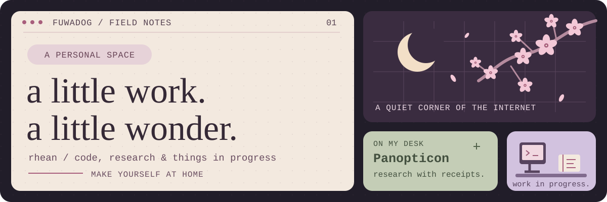
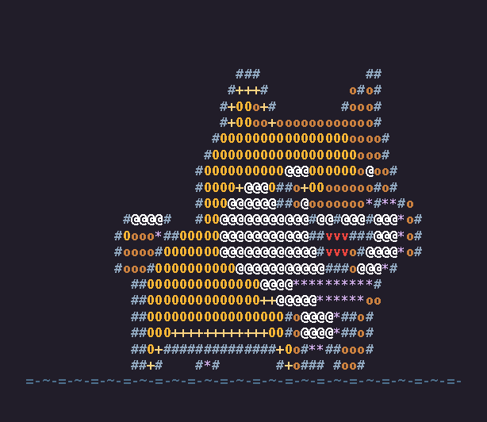
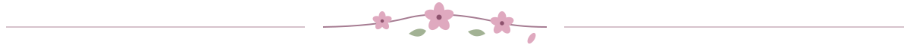
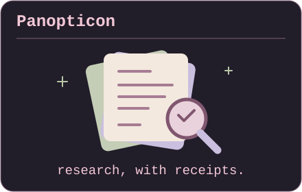
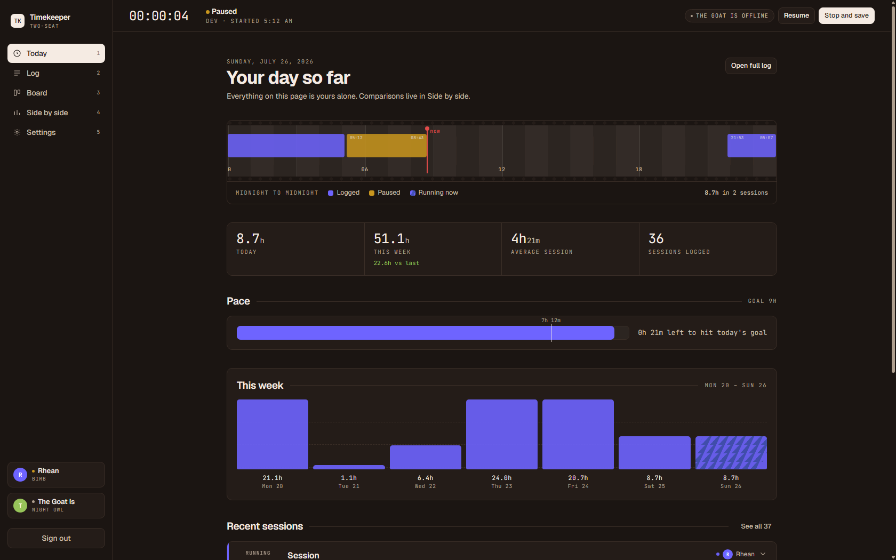
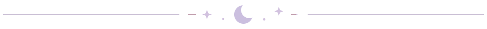

  <picture>
    <source media="(max-width: 767px)" srcset="assets/desktop-mobile.svg" />
    
  </picture>

# hey, i'm rhean.

**also fuwadog.** A little about my work, the things I make for myself, and the tools scattered across my desk.

[the day job](#the-day-job--the-personal-stuff) &nbsp; / &nbsp; [panopticon](#panopticon) &nbsp; / &nbsp; [timekeeper](#timekeeper) &nbsp; / &nbsp; [toolbox](#the-toolbox) &nbsp; / &nbsp; [say hello](#leave-a-little-note)

## the day job & the personal stuff

<!-- Native headings and a dedicated gutter survive GitHub's README sanitization. -->
<table width="100%">
  <tr><td width="58%" valign="top">
    <h3><strong>01 / Where I spend my days</strong></h3>
    
<strong>Work, then a little wonder.</strong>

    
I'm the <strong>CTO &amp; co-founder of <a href="https://www.linkedin.com/company/mdbspolaris/">Polaris</a></strong>. I work full-time, on-site.

    
<strong>My work stack</strong>

    
Astro · Cloudflare Google Cloud · AWS

    
Company details live on LinkedIn. This space is mostly for the person behind the job title.

    

    
<strong>Off the clock:</strong> my current favorite project is <a href="#panopticon">Panopticon</a>, a private research tool I use with AI assistants.

  </td><td width="4%"></td><td width="38%" valign="top">
    <h3><strong>02 / The resident shiba</strong></h3>
    

    
<strong>Currently around my desk</strong>

    
Research tools &amp; MCP. Web apps with personality. Local-first experiments.

    
<a href="https://rhean-dev.vercel.app/">Portfolio ↗</a> · <a href="https://www.linkedin.com/in/rhean-salibio/">LinkedIn ↗</a>

  </td></tr>
</table>

## Panopticon

<table width="100%" border="1" cellpadding="20" cellspacing="0">
  <tr><td width="60%" valign="top">
    <h3><strong>03 / The project getting most of my attention</strong></h3>
    
<strong>Research, with receipts.</strong>

    
My personal research workspace for AI assistants.

    
The aim is simple: <strong>useful results with sources I can check.</strong>

    
I'm using it and continuing to improve it, but keeping the implementation details private cause i'm shy lol.

  </td><td width="40%" valign="top">
    

    
<strong>Private project</strong>

    
In use · Still growing

  </td></tr>
</table>

## Timekeeper

**Two people. One scoreboard. A little friendly competition.**

<table width="100%" border="1" cellpadding="20" cellspacing="0">
  <tr><td colspan="2" align="center">
    

    
<a href="assets/timekeeper.png">View full-size dashboard ↗</a>

  </td></tr>
  <tr><td width="60%" valign="top">
    <h3><strong>04 / Something a little different</strong></h3>
    
<strong>Time tracking, together.</strong>

    
A two-person app built around <strong>mutual accountability</strong>.

    
Just two people tracking their time and comparing their days.

    <ul>
      <li>
<strong>Track your time</strong> Live sessions. Pause, resume, stop, and save.
</li>
      <li>
<strong>Compare your days</strong> Side-by-side stats, timelines, and 35-day activity grids.
</li>
      <li>
<strong>Keep going</strong> Crown scores, streaks, and Early Bird, Night Owl, and Birb badges.
</li>
      <li>
<strong>Take it along</strong> Install on mobile or desktop as a PWA.
</li>
    </ul>
    
<a href="https://time-tracker-ivory-two.vercel.app/"><strong>Open Timekeeper ↗</strong></a> Live app · Private source

  </td><td width="40%" valign="top">
    <h3>The quieter side of my projects</h3>
    
Panopticon makes research easier to inspect.

    
Timekeeper makes time tracking a little less solitary.

    

    
<strong>Built with</strong>

    

      
      
    

    

      
      
    

    

      
      
    

  </td></tr>
</table>

## the toolbox

What I'm using lately, grouped by where it actually shows up. Not a list of everything I've ever opened.

<table width="100%" border="1" cellpadding="20" cellspacing="0">
  <tr><td width="50%" valign="top">
    <h3><strong>05 / At work</strong></h3>
    
<strong>Web &amp; cloud</strong>

    
Astro for the web side. Cloudflare, Google Cloud, and AWS for the cloud stack.

    

      
      
    

    

      
      
    

  </td><td width="50%" valign="top">
    <h3><strong>06 / Personal toolbox</strong></h3>
    
<strong>Local tools &amp; research</strong>

    
TypeScript &amp; Bun. SQLite &amp; Docker.

    

      
      
    

    

      
      
    

  </td></tr>
  <tr><td colspan="2" valign="top">
    <h3>Also in the drawer / Web apps</h3>
    
The tools behind Timekeeper and other web projects.

    

      
      
      
    

    

      
      
      
    

  </td></tr>
</table>

## the public github shelf

Some of my work lives in private repositories. These cards are just the public-facing slice.

<!-- Explicit image widths cap the cards on wide screens; GitHub constrains images on smaller screens. -->

  
  

  

## leave a little note

<table width="100%">
  <tr><td width="58%" valign="top">
    <h3>Making something interesting?</h3>
    
I'm happy to talk about projects, research tools, or what you're working on.

    
No pitch required.

    
<a href="mailto:andrerhean@gmail.com">Email</a> · <a href="https://www.linkedin.com/in/rhean-salibio/">LinkedIn</a> · <a href="https://rhean-dev.vercel.app/">Portfolio</a>

  </td><td width="4%"></td><td width="38%" valign="top">
    <h3><strong>07 / Before you go</strong></h3>
    
Thanks for stopping by.

    
This is a little home for the things I'm building, not the whole résumé.

    
🌸 rhean / fuwadog

  </td></tr>
</table>
